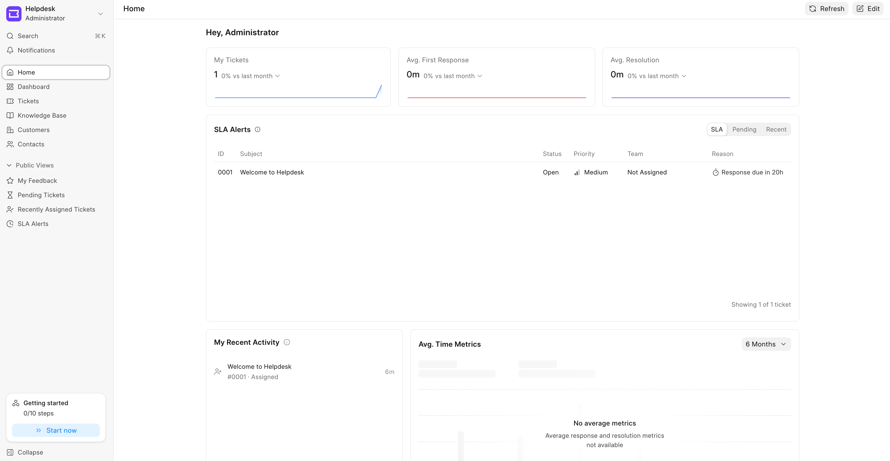

# Azure Support Ticketing

Ticketing system for a 6-person IT support company, deployed on Microsoft Azure
as Infrastructure as Code (Bicep). Proof of concept for replacing osTicket
with Frappe Helpdesk.

## Architecture



- Virtual network `10.0.0.0/16` with two subnets: `snet-app` (`10.0.1.0/24`)
  and `snet-db` (`10.0.2.0/24`)
- Network Security Group on `snet-app`: inbound SSH (22) and Frappe (8000, 9000)
  allowed only from one admin IP, everything else blocked by the default rules
- Ubuntu 24.04 LTS VM (`Standard_D2s_v5`), SSH key authentication only,
  password login disabled
- Static public IP and network interface
- Resource group budget with an e-mail alert at 80% of the limit
- Frappe Helpdesk installed automatically by cloud-init (Docker Compose), reachable on port 8000 only from the admin IP
  
> Note: Frappe runs from the upstream development Docker setup (default admin
> credentials, HTTP only). Proof of concept, not a production deployment.

## Deploy

```bash
az group create --name rg-ticketing-dev --location germanywestcentral

az deployment group create \
  --resource-group rg-ticketing-dev \
  --template-file infra/main.bicep \
  --parameters myIp=$(curl -4 -s ifconfig.me) \
               adminPublicKey="$(cat ~/.ssh/id_ed25519.pub)" \
               budgetEmail=you@example.com
```

Preview changes first with `az deployment group what-if` (same parameters).
Clean up: `az group delete --name rg-ticketing-dev --yes`

## Roadmap

- [x] Network, NSG, VM and budget as code
- [x] Frappe Helpdesk in Docker on the VM (cloud-init)
- [ ] Backups with a tested restore
- [ ] Azure Monitor alerts
